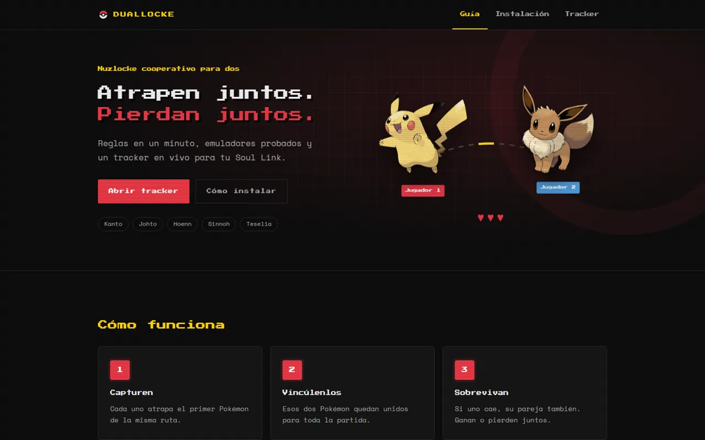
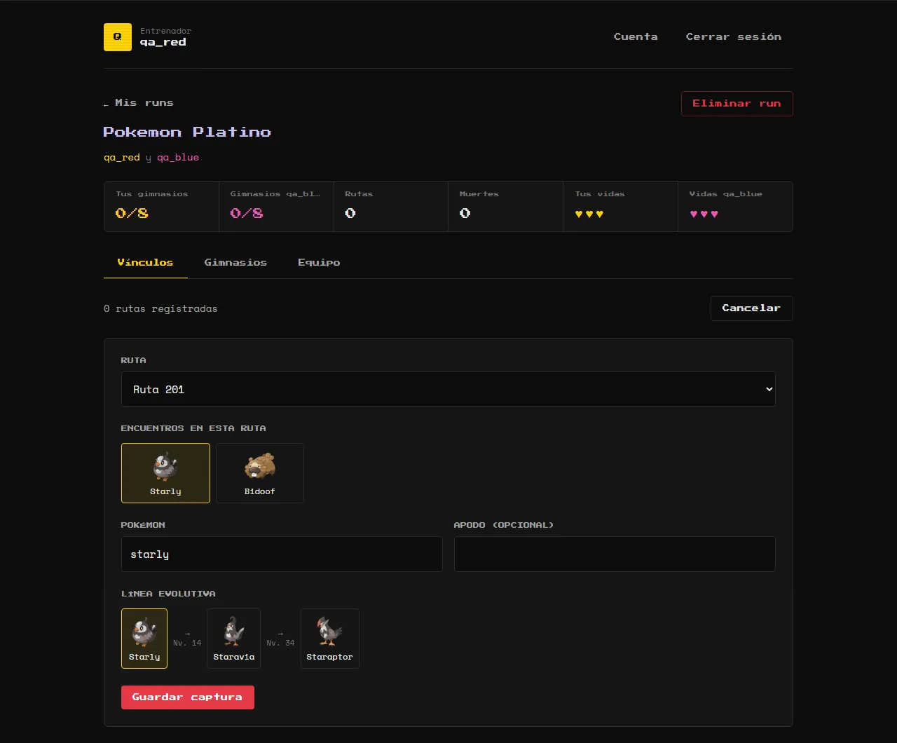
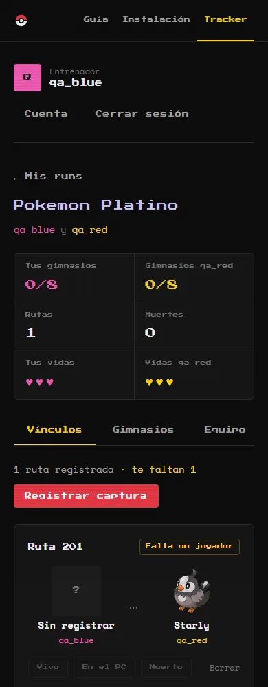

<div align="center">

# Duallocke Soul Link

**Guide and live tracker for playing a two-player Pokémon Soul Link Nuzlocke.**

[Live site](https://duallocke.pages.dev) · [Tracker](https://duallocke.pages.dev/tracker) · [Report a bug](https://github.com/CarlosFloresDev/duallocke/issues)


</div>



## Overview

In a Soul Link, two players run the same region at the same time. The first Pokémon each player catches on a route is linked to the partner's catch: if one faints, both are lost. Duallocke keeps both sides of the run in one place.

- **Runs for two** - create a run, share a 6-character invite code and your partner joins from their account.
- **Soul links per route** - each player registers their own catch; the route shows both Pokémon with sprites, nickname and status (alive, boxed, dead).
- **Route encounters and evolutions** - pick from the encounter table of the selected route and register the evolved form from the evolution line (PokeAPI).
- **Shared lives** - choose 1, 2, 3, 5 or unlimited lives. A dead link costs both players a life; the run ends at zero and recovers if a death is undone.
- **Gyms and teams** - per-player gym progress for 14 games, and a 6-slot active team that warns when a linked partner is missing.
- **Live sync** - both screens update within seconds of any change.
- **Guide pages** - rules, emulator setup and connection tips for NDS and GBA.

| Tracker | Mobile |
|---|---|
|  |  |

## Architecture

```
Browser (Astro static pages + React island)
   │  fetch /api/*  (session cookie, same-origin)
   ▼
Cloudflare Pages Functions ── Hono router ── zod validation
   │
   ▼
Cloudflare D1 (SQLite)
```

- **Static first.** Guide pages are prerendered HTML; only the tracker hydrates React.
- **API.** A single Pages Function (`functions/api/[[route]].ts`) mounts a Hono app from `server/`. Every request body is validated with zod and every run query is scoped to its two members, so other users' runs return 404.
- **Auth.** Username and password, hashed with PBKDF2-SHA256 (100k iterations, per-user salt). Sessions are random 256-bit tokens stored only as SHA-256 hashes, sent as `HttpOnly`, `Secure`, `SameSite=Lax` cookies with a 30-day sliding expiry. Login attempts are rate limited and cross-origin writes are rejected.
- **Sync.** Each write bumps `runs.version` in the same batch. Clients poll that single integer every 3 seconds (paused while the tab is hidden) and refetch the run only when it changes.
- **Game rules on the server.** Lives, run status and team limits are computed server-side in `server/lives.ts` and covered by unit tests.

```
src/
├─ components/tracker/   React UI: auth, dashboard, run view, links, gyms, team
├─ hooks/                useAuth, useRunData (version polling)
├─ lib/                  API client, PokeAPI client, shared types
├─ data/                 Gyms, routes and encounter tables for 14 games
└─ pages/                Guide, installation and tracker pages
server/                  Hono app, auth, crypto, validation, game rules
functions/api/           Cloudflare Pages Function entry point
migrations/              D1 schema
tests/                   Vitest unit tests
```

## Getting started

Requirements: Node 20+ and a Cloudflare account for deployment.

```bash
npm install
npm run db:migrate:local   # create the local D1 database
npm run dev:full           # build and serve UI + API at http://localhost:8788
```

For UI work with hot reload, run `npm run preview` in one terminal (API on :8788) and `npm run dev` in another; Astro proxies `/api` to the preview server.

## Scripts

| Command | Description |
|---|---|
| `npm run dev` | Astro dev server (UI, proxies `/api`) |
| `npm run dev:full` | Build and run UI + API locally with Wrangler |
| `npm run check` | Astro and TypeScript type checks |
| `npm test` | Unit tests (Vitest) |
| `npm run db:migrate` | Apply migrations to the production D1 database |
| `npm run deploy` | Build and deploy to Cloudflare Pages |

## Deployment

1. `npx wrangler d1 create duallocke` and copy the id into `wrangler.toml`.
2. `npm run db:migrate`
3. `npm run deploy`

GitHub Actions runs type checks, tests and a production build on every push.

## Adding a game

Add an entry to `GAMES` in `src/data/games.ts` (gyms and routes) and, optionally, its encounter table in `src/data/encounters.ts` using PokeAPI slugs. New games are accepted by the API automatically.

## Disclaimer

Fan project with no affiliation to Nintendo, Game Freak or The Pokémon Company. Pokémon names and sprites belong to their owners; sprites are loaded from [PokeAPI](https://pokeapi.co).

## License

MIT © Carlos Llano
